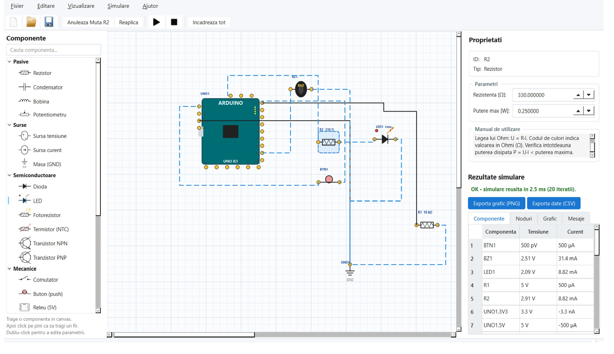

# Mesh - Simulator de Circuite Electrice (Python GUI)


Mesh este o aplicație desktop realizată în Python pentru **desenarea și simularea circuitelor electrice în regim DC**. Circuitul se construiește vizual, prin drag-and-drop, iar motorul de calcul determină:

- **Tensiunile în noduri**
- **Curenții și tensiunile pe componente**
- **Puterea disipată** (cu avertismente la depășirea limitelor)

Calculul se face prin **Analiză Nodală Modificată (MNA)**, cu o **iterație cu damping** peste modele liniare pe porțiuni pentru elementele neliniare (diode, LED-uri, tranzistoare). Aplicația rulează complet local, fără conexiune la internet, și are un accent didactic: erorile sunt explicate (unde și de ce), iar fiecare componentă are o scurtă descriere.

Proiect realizat în echipă (Facultatea de Inginerie Industrială și Robotică, UNSTPB, echipa 631AB): Andrei, Manole, Pralea.



---

## Funcționalități

- Canvas interactiv cu **drag-and-drop** pentru componente, **Undo / Redo**
- Conectare **pin-la-pin** cu fire și validarea conexiunilor
- Setarea parametrilor fiecărei componente (ex: rezistență, tensiune, putere maximă)
- **Simulare DC** (punct static de funcționare) prin MNA
  - iterație cu damping și modele companion pentru elemente neliniare
  - Rezistență parazită minimă pentru a evita singularitățile
- **Animație vizuală** a curentului prin circuit
- Rezultate numerice per nod și per componentă, plus tab de **mesaje** (erori și avertismente cu locație, motiv și sugestie de rezolvare)
- Salvare / încărcare proiecte în format **JSON** (fișiere portabile, fără bază de date)
- **Export al schemei** ca imagine PNG (cu sau fără valorile parametrilor)
- **Autosave** la 30 de secunde și **fișiere log** în `%APPDATA%\SimulatorCircuiteElectrice`
- Exemple gata făcute în folderul `examples/`
- Doar dependențe ușoare (PyQt6, NumPy)

---

## Componente suportate

| Categorie | Componente |
|---|---|
| Pasive | Rezistor, condensator, bobină, fotorezistor, termistor, potențiometru |
| Surse | Sursă de tensiune, sursă de curent, masă (GND) |
| Semiconductoare | Diodă, LED, tranzistor BJT NPN / PNP |
| Măsurare | Voltmetru, ampermetru, senzor LM35, senzor ultrasonic |
| Comandă și execuție | Întrerupător, buton, releu, buzzer, servomotor, motor DC |
| Microcontroler | Arduino UNO (simulat) |

Simbolurile grafice sunt desenate în cod, conform **IEC 60617 / ANSI Y32.2**.

---

## Tehnologii utilizate

- **Python 3.10+**
- **PyQt6** pentru interfața grafică (QGraphicsScene / QGraphicsView)
- **NumPy** pentru rezolvarea sistemului liniar
- **JSON** pentru salvarea proiectelor

---

## Logica internă a programului

1. Utilizatorul construiește circuitul pe canvas (componente, fire, parametri)
2. `data_parsing.parse_circuit` identifică nodurile (pini conectați prin fire), alege masa ca nod de referință și validează topologia
3. Fiecare componentă este transformată într-un element cu **stampilă MNA** (`models.py`)
4. `calculate_sys` construiește sistemul `A·x = z` și îl rezolvă cu `numpy.linalg.solve`
   - circuit liniar: o singură rezolvare
   - circuit cu elemente neliniare: iterații cu damping peste modele liniare pe porțiuni, până la convergență
5. Din tensiunile nodale se calculează curenții și puterile pe componente
6. Motorul **nu aruncă excepții către interfață**: orice problemă este returnată ca date (`SimError` cu locație, motiv și sugestie)
7. Rezultatele sunt afișate în interfață, iar curentul poate fi animat pe fire

Detalii suplimentare în folderul `docs/`.

---

## Instalare și rulare

```bash
git clone https://github.com/<utilizator>/Mesh-Circuit-Simulator.git
cd Mesh-Circuit-Simulator
pip install -r requirements.txt
python main.py
```

---

## Structura proiectului

```
Mesh-Circuit-Simulator/
├─ main.py
├─ requirements.txt
├─ README.md
├─ .gitignore
├─ .gitattributes
├─ src/
│   ├─ calculation/      # parsing circuit, modele de componente, motor MNA
│   ├─ components/       # catalog, componente grafice, pini, fire, iconițe
│   ├─ components_logic/ # comenzi Undo/Redo, paletă, logică fire
│   ├─ export/           # export schemă (PNG)
│   ├─ persistence/      # salvare/încărcare JSON, log, autosave
│   └─ ui/               # fereastra principală, vizualizare, panouri
├─ examples/
│   ├─ voltage_divider.json
│   ├─ arduino_night_light.json
│   └─ arduino_buzzer_button.json
└─ docs/
    ├─ arhitectura.md
    ├─ cerinte.md
    ├─ motor-simulare.md
    └─ Interface.jpg
```

---

## Limitări cunoscute

- Simularea este în **regim DC** (punct static de funcționare); analiza tranzitorie nu este implementată
- Calculul se rulează la apăsarea butonului de simulare, nu continuu

---

## Licență

Acest proiect este distribuit sub licența MIT.

---

## Contact

Pentru întrebări sau sugestii:
- manoledaniel2004@gmail.com
- https://www.linkedin.com/in/manoledaniel/
